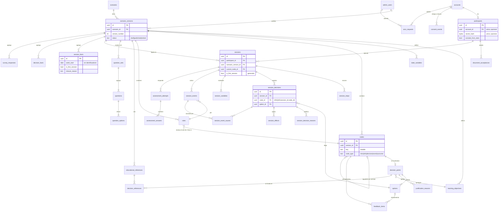
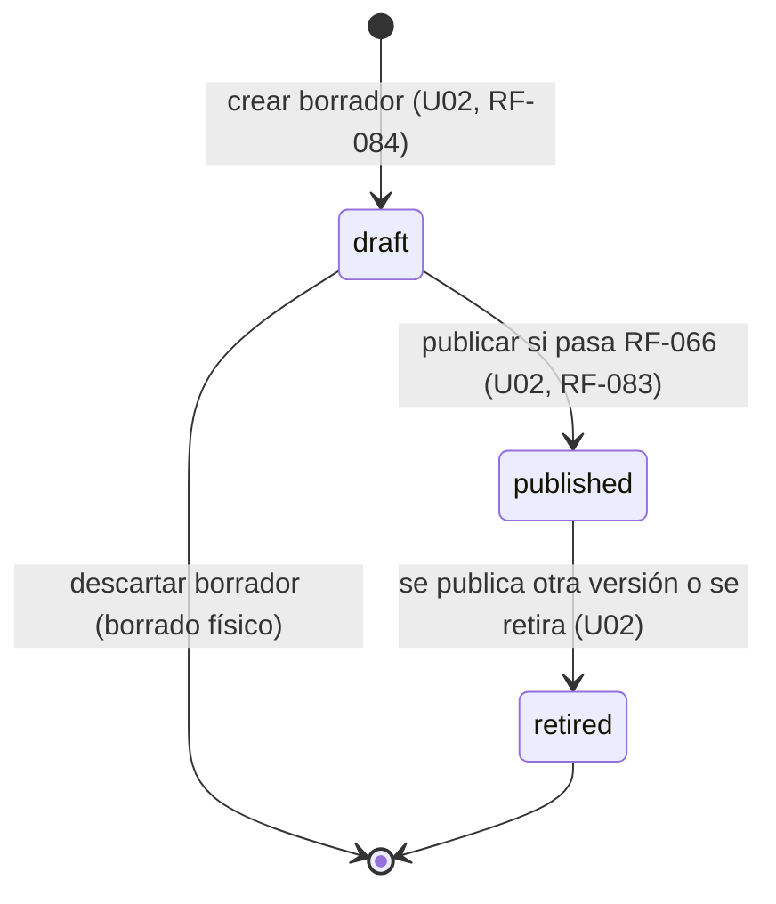
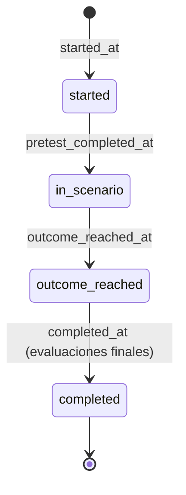
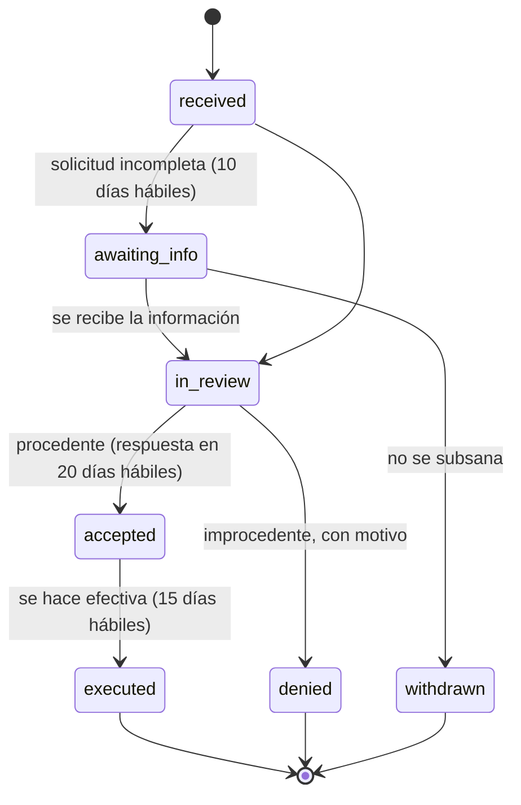

# Modelo de datos de Nukyro

Modelo lógico y físico de la base de datos de Nukyro, el simulador de decisiones éticas, para el MVP. Cubre entidades, relaciones, estados, reglas garantizadas, privilegios, procesos transaccionales y retención. Las columnas obvias (títulos, textos, posiciones) y los valores por omisión menores se definen en el DDL de referencia ([`bd/schema.sql`](schema.sql)) y después en las migraciones de Alembic.

**Fuente de verdad:** `context/proyecto/kg.json`. Este documento cita sus identificadores: RF, RN, RNF, OR, ADR y CONF.

## 0. Convenciones

| Tema | Convención | Origen |
| --- | --- | --- |
| Idioma | Identificadores en inglés; documentación en español | DEC-IDIOMA-ID |
| Nombres | `snake_case`, tablas en plural, llaves foráneas `<entidad>_id`; esquema `nukyro` | Plan H-08 |
| Llaves | `id uuid DEFAULT gen_random_uuid()`. La aplicación puede enviar UUID v7. La excepción es `admin_audit_log`, con `bigint` identidad porque solo se inserta | ADR-001 §4, plan H-01 |
| Claves estables | `key text` única por versión (`D03`, `D03-B`) en todo el contenido | ADR-001 §3 |
| Fechas | `timestamptz` en UTC. Las fechas límite legales (días hábiles) son `date`, calculadas por la aplicación | Plan H-08 |
| Catálogos | `text` + `CHECK`, sin `ENUM` | Detalle menor D |
| JSON | `jsonb` solo en `rules.condition`, `options.effects` y `admin_audit_log.detail` | ADR-001 §1 |

**Glosario español → inglés:** escenario `scenario` · versión `scenario_version` · nodo `node` · punto de decisión `decision_point` · alternativa `option` · razón de justificación `justification_reason` · regla (condición) `rule` · variable de estado `state_variable` · retroalimentación `feedback_item` · referencia educativa `educational_reference` · conjunto de preguntas `question_set` · participante `participant` · cuenta `account` · sesión `session` · intento de evaluación `assessment_attempt` · resultado anónimo `*_facts` · solicitud ARCO `arco_request`.

## 1. Decisiones de base

| Decisión | Resumen | Registro |
| --- | --- | --- |
| Motor y stack | PostgreSQL 16 en RDS, FastAPI, SQLAlchemy 2.x + Alembic (confirmado) | ADR-005 |
| Roles separados | `nukyro_api` (participantes) y `nukyro_admin` (panel) con permisos distintos | §6, decisión del usuario sobre F4 |
| Contenido | Tablas por elemento + `jsonb` para reglas; versiones `draft → published → retired`; claves estables | ADR-001 |
| Identidad | `participants` como raíz (navegador o cuenta); secreto por participante guardado como hash; administradores aparte | ADR-002 |
| Motor de simulación | Decisión idempotente con `UNIQUE(session_id, node_id)`; efectos, variables, eventos y causas en una transacción; fase calculada | ADR-003 |
| Estadísticas | Tablas de hechos anónimas (semana, sin identificadores) escritas al confirmar o al cerrar | ADR-004 |
| Integridad entre versiones | Llaves foráneas compuestas `(version_id, id)`: una sesión no puede apuntar a contenido de otra versión | Plan H-09 |
| Referencias internas del contenido | `DEFERRABLE INITIALLY DEFERRED`: se verifican al `COMMIT` (siguiente nodo, objetivo, reglas, preguntas) | Plan H-11 |

## 2. Diagrama entidad-relación

Las tablas de hechos (`session_facts`, `decision_facts`, `survey_responses`) **no tienen relación con sesiones, participantes ni cuentas**; solo con la versión del escenario, que es contenido. `admin_audit_log` no tiene llaves foráneas (ADR-004 §6).

## 3. Entidades

Solo columnas no obvias. Todas las tablas de contenido tienen `version_id` y `UNIQUE(version_id, id)` para las llaves compuestas (H-09).

### Contenido (ADR-001)

**`scenarios`** — escenario lógico; agrupa sus versiones. `key` es única (`BECAS`).

**`scenario_versions`** — versión del contenido; las sesiones la fijan (RN-15).

| Columna | Por qué | Origen |
| --- | --- | --- |
| `status` `draft/published/retired` | Solo `draft` se edita; una sola `published` y un solo `draft` por escenario | RN-16, ADR-001, H-10 |
| `based_on_version_id` | De qué versión se copió el borrador | RF-084 |
| `rubric_version` | Versión de los criterios de justificación aplicados | RF-059 |
| `published_at`, `published_by`, `retired_at` | Coherentes con el estado (`CHECK`) | RF-083 |

**`learning_objectives`** — objetivos de aprendizaje de la versión (RN-10).

**`state_variables`** — `initial_value`, `min_value` y `max_value` enteros (RF-027). `indicator_label` es el indicador narrativo visible; nunca se muestra el número (RF-035).

**`nodes`** — `node_type` (RF-015), `project_phase` (fase del caso), `default_next_node_id` (RF-032; nulo en desenlaces).

**`decision_points`** — 1:1 con un nodo de tipo decisión.

| Columna | Por qué | Origen |
| --- | --- | --- |
| `requires_justification` | Bloquea el avance sin justificación | RF-023, RF-024 |
| `evaluated_for_h05`, `min_correct_reasons` | Las 4 decisiones evaluadas y su criterio | RF-059, H05 |
| `learning_objective_id`, `affected_parties` | Vínculo pedagógico obligatorio | OR-05, H-05 |

**`options`** — alternativa. `effects jsonb` es un arreglo de `{variable_key, op, value}` (RF-028). `next_node_id` es una transición propia opcional. `UNIQUE(node_id, id)` permite que la base garantice RN-03.

**`justification_reasons`** — razones predefinidas por decisión, con `is_correct` según la rúbrica (CONF-03, RN-21).

**`rules`** — condiciones. `rule_type` `transition/event`; `from_node_id` (se evalúa al salir de ese nodo); `condition jsonb`; `target_node_id`; `relation_type` `causal/risk` (RF-041); `priority`; `explanation` (texto de la reconstrucción). Origen: RF-030 a RF-033.

**`educational_references`** — `ref_category` `ethical/professional/normative/legal` (RN-09, RF-043). `jurisdiction` es obligatoria si la categoría es `legal` (RN-08, RF-046). `section`, `version_label`, `consulted_on`, `valid_from` (RF-047).

**`decision_references`** — N:M entre decisión y referencias (RF-044).

**`feedback_items`** — retroalimentación por nodo y, opcionalmente, por alternativa, con `category` (RF-042, RF-043).

**`question_sets`** — un conjunto por tipo (`pretest/posttest/transfer/causal`) y versión (RN-13); `requires_all_answers` (RF-011).

**`questions`**

| Columna | Por qué | Origen |
| --- | --- | --- |
| `learning_objective_id` | Cada evaluación se liga a objetivos | RN-11 |
| `topic` | "Aciertos por tema" de las estadísticas | Aviso proceso 10 |
| `assesses_decision_node_id` | Qué pregunta comprueba cada decisión | OR-05 |
| `requires_node_id` | La pregunta causal solo aplica si la sesión pasó por ese evento o desenlace | RF-058, C6 |

**`question_options`** — `is_correct` con índice único parcial: exactamente una correcta por pregunta (RF-009).

**`admin_users`** — administradores ligados a `cognito_sub`. El rol lo decide el grupo `admins` de Cognito (ADR-002 §7).

### Identidad (ADR-002)

**`accounts`**

| Columna | Por qué | Origen |
| --- | --- | --- |
| `cognito_sub` único | Vínculo con Cognito, que es la fuente de verdad de las credenciales | ADR-002 |
| `email` | Copia declarada en el Aviso; se usa para verificar ARCO | Aviso 2.1 proc. 1 |
| `nickname` | No único | DEC-NICKNAME |
| `newsletter_opt_in`, `surveys_opt_in` | Valor vigente de las finalidades secundarias; el historial con fechas está en `consent_events` | Aviso §6, decisión del usuario sobre N4 |
| `status`, `blocked_at`, `block_reason`, `deletion_due_at` | Bloqueo de 30 días antes de eliminar | RF-080, DEC-BLOQUEO |
| `last_login_at` | Inactividad de 12 meses | RET-01 |

**`participants`** — raíz de la propiedad de los datos.

| Columna | Por qué | Origen |
| --- | --- | --- |
| `account_id` único, opcional | Una cuenta tiene un solo participante | ADR-002 §4 |
| `secret_hash bytea(32)` único, opcional | SHA-256 del secreto de reanudación | RF-062 |
| `CHECK (account_id IS NOT NULL OR secret_hash IS NOT NULL)` | Todo participante es identificable por algún medio | ADR-002 |
| `exclude_from_stats` | Oposición a las estadísticas | RF-079 |
| `last_activity_at` | Caducidad de 30 días sin cuenta | RF-080 |

**`consent_events`** — historial de consentimientos opcionales: `consent_type` (`newsletter/surveys`), `granted` (otorga o revoca), `source` (`registration/settings/unsubscribe_link/arco_request`) y `occurred_at`. Solo admite inserción, y cada cambio de `accounts.*_opt_in` inserta un evento en la misma transacción. Acredita cuándo se otorgó o revocó cada consentimiento (Aviso §6 y §12; decisión del usuario sobre N4).

**`document_acceptances`** — `document_type` `age_18_plus/privacy_notice/terms`, `document_version` y `accepted_at`, con `UNIQUE NULLS NOT DISTINCT` (RF-073).

**`arco_requests`** — `account_id` con `ON DELETE SET NULL`: la solicitud sobrevive a la cuenta para acreditar que se atendió. También guarda `requester_email`, `right_type`, `status` (§4), las fechas límite `response_due_on`, `info_due_on` y `execution_due_on` (`date`, días hábiles calculados por la aplicación), `extended` con su `extension_reason`, `denial_reason` e `identity_doc_key` (objeto en S3, nulo al cerrar). Origen: RF-085, RF-086, H-06.

### Simulación (ADR-003)

**`sessions`**

| Columna | Por qué | Origen |
| --- | --- | --- |
| `scenario_version_id` | Versión fijada; `UNIQUE(id, scenario_version_id)` la propaga a las hijas | RN-15, H-09 |
| `current_node_id`, `outcome_node_id` | Llave compuesta con la versión | RF-006, RF-037 |
| `started_at`, `pretest_completed_at`, `outcome_reached_at`, `completed_at` | Hitos; la fase se calcula a partir de ellos | RF-005, RF-061 |
| `self_reported_first`, `has_prior_session`, `is_first_session` (generada) | Criterio de primera sesión | RF-077, RN-18 |
| `survey_answered` | Único rastro de la encuesta en la sesión | RF-060 |
| `facts_written_at` | Evita escribir `session_facts` dos veces | ADR-004 |
| `last_activity_at` | Inactividad | RF-080 |

**`session_steps`** — cada cambio de nodo con `seq`, para la reanudación y el análisis de tiempos (RF-006).

**`session_decisions`** — `UNIQUE(session_id, node_id)` (RN-14). Llaves compuestas: el nodo pertenece a la versión de la sesión y la alternativa pertenece al nodo (RN-02, RN-03). `justification_correct` se calcula al confirmar (RF-059).

**`session_decision_reasons`** — razones elegidas; la razón pertenece al mismo nodo (llave compuesta).

**`session_variables`** — valor actual por variable (RF-026); la variable pertenece a la versión de la sesión.

**`session_effects`** — `old_value` y `new_value` de cada efecto aplicado (RF-040).

**`session_events`** — regla activada (`UNIQUE(session_id, rule_id)`). El destino y el tipo de relación se leen de la regla, que es inmutable (RF-031, RF-041).

**`session_event_causes`** — decisiones que contribuyeron; solo de la misma sesión (RF-034, RF-065).

**`assessment_attempts`** — `UNIQUE(session_id, question_set_id)` (RN-19). `score numeric(5,2)` de 0 a 100, nulo si está incompleto (RF-011).

**`assessment_answers`** — una respuesta por pregunta; la pregunta pertenece al conjunto y la opción a la pregunta (llaves compuestas).

### Estadísticas y bitácora (ADR-004)

**`session_facts`** — `week_start date` (lunes ISO), `closure_reason`, `is_first_session`, puntuaciones de pre-test y post-test, aciertos y totales de transferencia, causales y de justificación, `outcome_reached`, `outcome_key`, `evaluations_completed` y `duration_bucket_min` (múltiplo de 5). Alimenta H02 a H06.

**`decision_facts`** — `decision_key`, `option_key`, `is_first_session`, `week_start` (Aviso proceso 10).

**`survey_responses`** — escalas de 1 a 5: `usefulness` (H07), `clarity`, `decision_impact`, `causal_understanding`, `summary_usefulness`, `would_repeat` (EVAL-DISENO).

**`admin_audit_log`** — `admin_user_id` opaco, `action`, `entity_type`, `entity_id` y `detail jsonb`, sin respuestas de participantes (RF-087, RNF-15).

## 4. Estados

### Versión de escenario (guardado)

Un trigger impide cualquier otra transición y cualquier cambio de contenido fuera de `draft`.

### Sesión (calculado, no se guarda)

Consulta: `CASE WHEN completed_at IS NOT NULL THEN 'completed' WHEN outcome_reached_at IS NOT NULL THEN 'outcome_reached' WHEN pretest_completed_at IS NOT NULL THEN 'in_scenario' ELSE 'started' END`. El **abandono** se calcula en el reporte: `outcome_reached_at IS NULL` al cierre del periodo de observación (RF-005).

### Cuenta (guardado)

```mermaid
stateDiagram-v2
    [*] --> active : registro con Cognito (RF-074)
    active --> blocked : solicitud de cancelación, 12 meses sin iniciar sesión, minoría de edad o incumplimiento
    blocked --> [*] : deletion_due_at vencido; tarea de purga escribe hechos y borra en cascada
```

No hay reactivación desde `blocked`; durante el bloqueo los datos no se usan (Aviso §10).

### Solicitud ARCO (guardado, refinado en H-06)

## 5. Reglas que garantiza la base de datos

| Regla | Mecanismo | Requerimiento |
| --- | --- | --- |
| Una sola versión publicada y un solo borrador por escenario | Índices únicos parciales `WHERE status = ...` | RN-16, H-10 |
| Lo publicado o retirado es inmutable; transiciones válidas | Trigger `guard_content_version` en las 13 tablas de contenido y `guard_version_status` | RN-15, RN-17, ADR-001 |
| Las sesiones nuevas solo usan versiones publicadas | Trigger `BEFORE INSERT` en `sessions` | RN-15 |
| Primera confirmación fija; un reintento no duplica | `UNIQUE(session_id, node_id)` + `ON CONFLICT DO NOTHING` | RN-14, RF-064 |
| La alternativa pertenece al nodo y el nodo a la versión de la sesión | Llaves foráneas compuestas | RN-02, RN-03 |
| Razones, variables, eventos y causas son de la misma sesión y versión | Llaves foráneas compuestas | RN-05, RF-065 |
| Un intento por conjunto en cada sesión | `UNIQUE(session_id, question_set_id)` | RN-19 |
| La pregunta pertenece al conjunto y la opción a la pregunta | Llaves foráneas compuestas | RF-009, RN-13 |
| Una sola opción correcta por pregunta | Índice único parcial | RF-009 |
| Toda referencia legal tiene jurisdicción | `CHECK` | RN-08, RF-046 |
| Coherencia de hitos y del desenlace | `CHECK` en `sessions` | RF-005, RF-061 |
| El participante es identificable; el hash mide 32 bytes | `CHECK` | RF-062 |
| Una cuenta, un participante; secreto único | `UNIQUE` | ADR-002 |
| Borrar el participante o la cuenta borra todo lo suyo | `ON DELETE CASCADE` | RF-070, RF-078, RF-080 |
| Una solicitud cerrada no conserva el documento de identidad | `CHECK (closed_at IS NULL OR identity_doc_key IS NULL)` | RF-086 |
| Hechos, bitácora e historial de consentimientos inmutables; analítica sin datos personales | Permisos (§6) | RF-072, RF-087, Aviso §12 |
| La API de participantes no modifica contenido ni ve ARCO; el panel no modifica sesiones | Permisos (§6) | RNF-03, F4 |

**Lo garantiza la aplicación (con pruebas):**
- la validación de publicación de RF-066 (alcanzabilidad, ciclos sin salida, destinos y que todo `decision_point` cuelgue de un nodo `decision`);
- la evaluación de `condition` y `effects`;
- los límites `min_value`/`max_value` al aplicar efectos;
- que una pregunta causal solo apunte a nodos `event` u `outcome`;
- el cálculo de días hábiles;
- el orden "escribir hechos y luego borrar";
- la regla de no escribir hechos si hay `exclude_from_stats`;
- el umbral de 10 participantes en los reportes (RN-20);
- la sincronización del correo con Cognito.

## 6. Acceso y privilegios

| Rol de base de datos | Proceso | Puede | No puede |
| --- | --- | --- | --- |
| `nukyro_owner` | Alembic (migraciones) | DDL; dueño del esquema | La aplicación nunca se conecta con él |
| `nukyro_api` | API FastAPI de participantes | `SELECT` del contenido; DML en identidad propia (cuentas, participantes, aceptaciones) y simulación; `INSERT` en `consent_events`, hechos y encuesta | Modificar contenido; leer o tocar `arco_requests`, `admin_users` y la bitácora; leer hechos |
| `nukyro_admin` | Panel de administración | DML en contenido y `admin_users`; `SELECT/INSERT/UPDATE` en `arco_requests`; `SELECT/UPDATE` en `accounts` y `participants` (rectificar, oponerse, bloquear); `SELECT` de la simulación (ARCO de acceso); `INSERT` en `consent_events` y en la bitácora | Borrar o modificar sesiones; leer hechos; borrar la bitácora |
| `nukyro_jobs` | Tareas programadas: caducidad, purga de cuentas, purga de bitácora | `SELECT` general; `UPDATE` de `accounts`; `DELETE` de `participants`, `accounts`, `admin_audit_log` y `arco_requests` (12 meses tras el cierre); `INSERT` en `session_facts` | Modificar contenido |
| `nukyro_analytics` | Reportes del piloto | `SELECT` solo de las tablas de hechos y del catálogo de versiones | Leer cualquier dato personal |

El aislamiento entre participantes lo hace la API (ADR-002 §6, D7): toda consulta filtra por el `participant_id` resuelto del secreto o del token de Cognito. No se usa seguridad por fila.

## 7. Procesos que cambian datos

### P5 · Confirmar decisión (una transacción, ADR-003)
1. `SELECT ... FROM sessions WHERE id = :s AND participant_id = :p FOR UPDATE`: serializa las peticiones de la misma sesión y valida `current_node_id = :node`.
2. `INSERT INTO session_decisions ... ON CONFLICT (session_id, node_id) DO NOTHING RETURNING id`. Si no devuelve nada, es un reintento: se responde con la decisión ya confirmada y se hace `COMMIT` sin más cambios (RN-14).
3. Insertar `session_decision_reasons` y calcular `justification_correct`.
4. Por cada efecto de `options.effects`: actualizar `session_variables` (con los límites) e insertar `session_effects`.
5. Evaluar las `rules` cuyo `from_node_id` es el nodo actual; insertar `session_events` y `session_event_causes`.
6. Resolver el siguiente nodo (regla de transición, luego `options.next_node_id`, luego `default_next_node_id`); insertar `session_steps`; actualizar `current_node_id` y `last_activity_at`; si es un desenlace, `outcome_node_id` y `outcome_reached_at`.
7. Si el participante no tiene `exclude_from_stats`, insertar `decision_facts`.

### P12 · Publicar versión
`SELECT ... FROM scenarios WHERE id = :sc FOR UPDATE` → la aplicación valida RF-066 → `UPDATE` de la versión publicada a `retired` → `UPDATE` del borrador a `published`. Si dos administradores publican a la vez, el índice parcial lo impide.

### P10 · Conservar el progreso al crear cuenta (ADR-002 §4)
Con `B` = participante del navegador (por `secret_hash`) y `A` = participante de la cuenta:
- **Si no existe `A`:** `UPDATE participants SET account_id = :acc, secret_hash = NULL WHERE id = B`.
- **Si existe `A`:**
  1. `UPDATE sessions SET participant_id = A WHERE participant_id = B`;
  2. copiar aceptaciones con `ON CONFLICT DO NOTHING`;
  3. `exclude_from_stats = A.excl OR B.excl`;
  4. `DELETE` de `B`;
  5. recalcular `has_prior_session` de las sesiones trasladadas: es verdadero si `A` ya tenía una sesión anterior del mismo escenario (§9.3, N1).

Todo en una transacción. Repetirla no hace nada, porque `B` ya no existe.

### P9 · Caducidad, cancelación y borrado
En una transacción por participante o cuenta:
1. por cada sesión con `facts_written_at IS NULL`, si no hay `exclude_from_stats`, insertar `session_facts` con el `closure_reason` que corresponda;
2. `DELETE FROM participants` (sin cuenta, `last_activity_at` de más de 30 días) o `DELETE FROM accounts` (`blocked` con `deletion_due_at` vencido). La cascada borra sesiones, decisiones, efectos, eventos, intentos y aceptaciones.

El mismo flujo sirve para RF-078 (borrado propio sin cuenta) y para ARCO de cancelación.

## 8. Borrado y retención

| Entidad | Tipo de borrado | Dependientes | Retención |
| --- | --- | --- | --- |
| `scenario_versions` y su contenido | Físico solo en `draft`; las publicadas o retiradas no se borran | Cascada del borrador a su contenido | Indefinida (contenido, no datos personales) |
| `participants` sin cuenta | Físico | Cascada a sesiones y aceptaciones | 30 días desde `last_activity_at` (RET-06) |
| `accounts` | Lógico (`blocked`) y después físico | Cascada a participante, sesiones y aceptaciones; `arco_requests.account_id` queda nulo | 12 meses de inactividad + 30 días de bloqueo (RET-01, DEC-BLOQUEO) |
| `sessions` y sus hijas | Físico por cascada | — | La del participante |
| `session_facts`, `decision_facts`, `survey_responses` | Ninguno | — | Sin plazo, porque son anónimos (RET-04) |
| `arco_requests` | Físico por tarea (`nukyro_jobs`) | — | 12 meses después de `closed_at` (H-07, aprobado por el usuario) |
| `consent_events` | Físico por cascada desde `accounts` | — | La de la cuenta |
| Documento de identidad en S3 | Físico al cerrar la solicitud | — | Mientras la solicitud está abierta (RF-086) |
| `admin_audit_log` | Físico por tarea | — | 90 días (RET-02) |
| Respaldos de RDS | Rotación automática | — | Periodo de retención de RDS; nunca reactivan cuentas (Aviso §10) |

## 9. Revisión, supuestos y pendientes

### 9.1 Validación realizada

- `bd/schema.sql` y `bd/seed-prueba.sql` se ejecutan sin errores en **PostgreSQL 16.15** (Docker `postgres:16`): 35 tablas.
- `bd/pruebas/pruebas-reglas.sql`: **52 de 52 pruebas pasan** (v0.2). Cubren RN-02, RN-03, RN-08, RN-14 (reintento), RN-15, RN-16, RN-17, RN-18, RN-19, RF-009, RF-065, RF-086, los permisos de los cuatro roles (incluida la separación entre API y panel), la cascada ejecutada por `nukyro_jobs` y la supervivencia de los hechos.
- **Diagramas Mermaid:** el usuario confirmó que se visualizan correctamente (2026-11-01).

### 9.2 Qué puede fallar

| # | Riesgo | Mitigación |
| --- | --- | --- |
| F1 | **Crear cuenta no es atómico:** Cognito crea el usuario y después la API inserta `accounts`. Si la segunda parte falla, queda un usuario de Cognito sin fila. | Crear o actualizar `accounts` con *upsert* por `cognito_sub` en cada inicio de sesión (idempotente). La fila se recupera sola. |
| F2 | **Borrar una cuenta toca dos sistemas:** Cognito (`AdminDeleteUser`) y la base. | La tarea borra primero en Cognito (si ya no existe, cuenta como éxito) y después en la base; si falla, reintenta al día siguiente. La cuenta sigue `blocked` y sin acceso mientras tanto. |
| F3 | **Documento de identidad ARCO en S3:** el `CHECK` obliga a nulificar la llave al cerrar, pero borrar en S3 no es transaccional. | Borrar en S3 y luego cerrar. Si el cierre falla, queda un objeto ya borrado y se reintenta. Como red de seguridad, una regla de ciclo de vida en el bucket. |
| F4 | ~~La API de participantes y el panel compartían rol.~~ **Resuelto en v0.2:** `nukyro_api` y `nukyro_admin` separados (T34b–T34h). | La aplicación FastAPI usa dos conexiones o dos usuarios: uno para las rutas de participantes y otro para las del panel. |
| F5 | **Claves estables cambiadas entre versiones:** si un administrador renombra `D03` en un borrador, `decision_facts` parte la estadística en dos. | El panel no permite editar `key` de elementos heredados de `based_on_version_id`; el validador de publicación lo verifica. |
| F6 | **Texto libre con datos personales:** `nickname`, `arco_requests.description` y `admin_audit_log.detail`. | Regla de código: `detail` nunca incluye valores de participantes. El nickname lo cubren los Términos §4.2. La descripción ARCO se borra con la solicitud (H-07). |
| F7 | **Errores diferidos:** las llaves `DEFERRABLE` fallan al `COMMIT`, no en la sentencia. | El panel debe capturar `IntegrityError` en el commit y mostrar el error (prueba técnica S5). |
| F8 | **Reglas en JSON apuntan a claves de texto** (`variable_key`, nodos), sin llave foránea. | El validador de publicación (RF-066) comprueba que cada clave exista en la versión. |
| F9 | **Celdas pequeñas:** con 50 participantes, una fila de `session_facts` por semana y versión puede ser única. | Umbral de 10 en los reportes (RN-20); no publicar cruces de `closure_reason` × semana. |

### 9.3 Casos que no cubre bien

| # | Caso | Estado |
| --- | --- | --- |
| N1 | **Conservar el progreso cuando la cuenta ya tenía una sesión del mismo escenario:** las sesiones trasladadas conservan `has_prior_session = false` y pueden aparecer dos "primeras sesiones". | Ajuste en P10: recalcular `has_prior_session` de las sesiones trasladadas. Los `decision_facts` ya escritos no se pueden corregir (sesgo menor, mitigado por la pregunta de RF-077). |
| N2 | **Pruebas del equipo contaminan las estadísticas:** integrantes que juegan con cuentas propias. | Marcar sus cuentas con `exclude_from_stats` antes del piloto. |
| N3 | **Abuso de "primera sesión":** borrar los datos propios (RF-078) y volver a empezar. | La sesión borrada deja `session_facts` con `closure_reason = 'self_deleted'`; la nueva depende de la respuesta declarada. Riesgo aceptado. |
| N4 | ~~Consentimientos opcionales sin fecha.~~ **Resuelto en v0.2:** tabla `consent_events` con el historial de otorgamientos y revocaciones. | La API y el panel insertan el evento en la misma transacción que cambia `accounts.*_opt_in`; lo garantiza el código, con prueba. |
| N5 | **Semana ISO y zona horaria:** una sesión el domingo a las 23:00 en México ya es lunes en UTC. | Detalle decidido: `week_start` se calcula en `America/Mexico_City`. |
| N6 | **Matriz de requerimientos → modelo:** RF-001 a RF-087 y RN-01 a RN-21 tienen tabla, columna o regla. Quedan fuera de la base, por diseño: los registros operativos de errores (RNF-15, en los logs del servicio), la preferencia de cookies (en el navegador) y el cálculo de días hábiles (en la aplicación). | Sin huecos de entidad. |

### 9.4 Supuestos que hay que probar antes de construir

| # | Supuesto | Prueba técnica | Plan B si falla |
| --- | --- | --- | --- |
| S1 | Los créditos del laboratorio permiten RDS PostgreSQL 16 y un user pool de Cognito (H-02) | Crear ambos en la cuenta del laboratorio, con conexión TLS desde la API | Sin Cognito: piloto solo sin cuenta (ACCESO-HIBRIDO parcial). Sin RDS: PostgreSQL 16 en EC2 o Lightsail con respaldos manuales |
| S2 | Los roles `NOLOGIN`, los permisos y los triggers del DDL se crean con el usuario maestro de RDS (`rds_superuser`, que no es superusuario) | Ejecutar `schema.sql` en la instancia RDS | Ajustar la propiedad de los objetos o crear los roles desde la consola |
| S3 | Alembic con SQLAlchemy 2 representa índices parciales, `NULLS NOT DISTINCT`, columnas generadas, llaves compuestas `DEFERRABLE` y triggers | Autogenerar la migración inicial y compararla con `schema.sql` | Escribir la migración inicial a mano con `op.execute()` a partir de `schema.sql` |
| S4 | `SELECT … FOR UPDATE` + `ON CONFLICT DO NOTHING` evitan efectos duplicados con peticiones concurrentes reales desde FastAPI | 1 000 pares de confirmaciones simultáneas sobre el mismo nodo; 0 efectos duplicados | Aislamiento `SERIALIZABLE` en P5 con reintento |
| S5 | Los errores de llaves diferidas llegan como `IntegrityError` en `session.commit()` y el panel los muestra | Borrar en un borrador un nodo referenciado y confirmar | Pasar a `SET CONSTRAINTS ALL IMMEDIATE` en las transacciones del panel |
| S6 | El borrado en cascada lo ejecuta `nukyro_jobs` sin permisos sobre las tablas hijas | **Comprobado en T38** (PostgreSQL 16.15) | — |

### 9.5 Decisiones del usuario (2026-11-01)

1. **H-07:** `arco_requests` se conserva 12 meses después del cierre. Aceptado.
2. **N4:** se guardan las fechas de los consentimientos opcionales. Implementado con `consent_events`.
3. **F4:** se separan los roles de la API de participantes y del panel. Implementado con `nukyro_api` y `nukyro_admin`.
4. **ORM:** SQLAlchemy 2.x + Alembic, confirmado (ADR-005).

5. **Pruebas técnicas S1–S5:** el equipo las da por validadas porque ya montó la misma configuración (RDS PostgreSQL, Cognito, FastAPI + SQLAlchemy/Alembic) en otros proyectos con los mismos créditos. Esta validación la reporta el equipo; no se repitió en este proyecto.

No quedan pendientes abiertos en el modelo.
